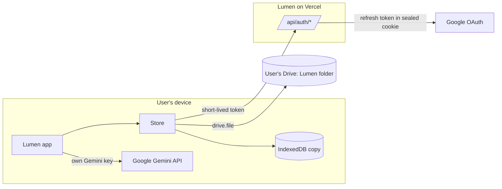

# How Lumen fits together

Lumen is a Next.js app (App Router, Next.js 16) that runs almost entirely on the user's device. Each person brings their own storage (Google Drive) and their own AI (a Gemini key), so Lumen stays free at any scale.

## Sign-in

- `/api/auth/google/start` sends the user to Google with PKCE and a random `state`. Scopes: `openid email profile drive.file`, with offline access.
- `/api/auth/google/callback` checks `state`, exchanges the code, and stores the session (Google refresh token included) in an `httpOnly` cookie sealed with AES-256-GCM (`src/lib/server/seal.ts`). There is no database of tokens.
- `/api/auth/token` hands the app a short-lived Google access token for Drive, refreshing it when needed.
- `/api/auth/signout` clears the cookie; `?disconnect=1` also revokes Lumen's access at Google.

## Storage (`src/lib/store`)

- `idb.ts`: a small key-value store in IndexedDB. Every read comes from here, so the app opens instantly and works offline.
- `drive.ts`: the Drive client. It finds or creates the `Lumen` folder and keeps one JSON file per document (`profile.json`, `ai.json`, `blocked.json`, `added.json`).
- `merge.ts`: every document is saved as `{ v, at }`. When the device and Drive disagree, the newer copy wins; on a tie the device copy stays.
- `store.ts`: writes go to the device first, are marked dirty, and sync to Drive about a second later, or when the device comes back online. `useStore()` re-renders components when anything changes.

Users who skip Google sign-in use "device" mode: everything stays in IndexedDB until they connect Drive from the You page.

## AI (`src/lib/gemini.ts`)

The user's own key is checked with Google (`GET /v1beta/models`) before it's saved, and every AI call goes straight from the device to Google. The key is stored only in the user's Drive and on their device.

## Daily plan (`src/lib/plan.ts`)

A pure function, so every device picks the same focus for the same day. Weekly and Daily areas appear once per cycle, starred areas twice (never on consecutive days), "Sometimes" areas every second cycle, and Sunday is the weekly review. News topics and paused areas never become a focus.

## Recommendations (`src/lib/recs.ts`, `src/lib/server/verify.ts`)

1. On the device, the user's own Gemini (with Google Search) is asked for specific, real items for one area. The prompt carries the goal, preferred formats, recent likes and dislikes, level feedback, links they added and everything they blocked.
2. `/api/verify` checks each suggestion and fills in title, creator, thumbnail and an embeddable player: YouTube oEmbed for videos, Shorts and playlists; TikTok, Vimeo, TED and X oEmbed; Open Library for books; Apple's podcast search for episodes; and a safe page fetch for articles (public addresses only, 3 redirects, 300 KB). Suggestions it can't confirm are dropped. It never sees user data or keys, and is rate-limited.
3. Blocked and down-rated items are filtered out, and the day's picks are saved (`picks.json`), so Learn doesn't change every time it opens.

## Daily session (`src/app/(app)/session`, `src/lib/session-ai.ts`, `src/lib/stats.ts`)

Warm-up questions, today's pick, a practice exercise with AI feedback, and a private reflection (`journal.json`, never sent to the AI). Finishing updates `stats.json`: streak (consecutive days), best streak and lumens (10/20/30/10 per step).

## Player (`src/components/player.tsx`)

YouTube plays through the IFrame API on youtube-nocookie with related videos off, saving position (and playlist index) every few seconds to `progress.json`; podcasts play in an audio player that also resumes.

## Library and reader (`src/lib/books`, `src/lib/reader`, `src/app/read`)

- Every book is turned into one format, chapters of paragraphs (`BookDoc`), so EPUB, PDF and plain text all read the same way:
  - EPUB (`books/epub.ts`): JSZip plus string parsing of the OPF, spine, table of contents (nav or NCX) and XHTML.
  - PDF (`books/pdf.ts`): pdf.js text extraction, lines rebuilt into paragraphs, chapters from the PDF's bookmarks or every 10 pages. Scanned PDFs are refused with a clear message.
  - Project Gutenberg (`server/gutenberg.ts`, `books/text.ts`): OPDS search, then the plain-text edition with header, licence and contents removed and chapters detected.
- Books are saved on the device (IndexedDB, for offline reading) and, when signed in, in the user's Drive under `Lumen/Books/` (the book as JSON plus the original upload). `library.json` lists them with shelf and progress; `reading.json` holds each book's place, highlights, notes and bookmarks; `readerSettings.json` the reader's look.
- PDFs open in their own reader (`components/pdf`), built like Selah's: the real pages in one continuous scroll (only pages near the screen are drawn), pdf.js's text layer for selecting, a slim toolbar (page box, zoom with fit to width, search, highlights, bookmarks, light/sepia/night, read aloud, full screen, download) and a side panel (contents, page thumbnails, highlights with export, bookmarks, search, Explain). PDF highlights are saved as boxes on the page (`rects`, fractions of the page) in `reading.json`, so they also appear in the Library's Highlights tab. The original file is kept on the device (`file:<id>`) and in Drive.
- EPUBs carry `look` (page colour, text colour, background image) read from the publisher's stylesheet; plain white counts as none, and books with no look keep Lumen's paper. EPUBs and free classics use the book reader below, with pages that simply change (or slide); there is no page-flip animation.
- The reader (`reader/engine.js`) is framework-free: CSS columns for pagination, a 3D leaf for page turns, a generated paper texture, selection-based highlights. `/read/[id]` mounts it and passes in the book, saved state and callbacks.

## Practice, Progress, news and Unwind (`src/lib/practice.ts`, `practice-ai.ts`, `progress.ts`)

- Flashcards (`cards.json`) use a simplified SM-2: Again brings a card back today, Good spaces it 1, 3, then interval × ease days, Easy further still. The buttons preview each interval. Cards come from the user, from the AI per area (language cards differ from concept cards), or from a book highlight (`hl-<highlight id>`, so each highlight makes one card).
- Drills (digit span, odd one out) and quiz scores go to `drills.json`. Practice adds lumens with `addLumens`, which never touches the streak: only the daily session keeps it.
- News: `/api/news` reads Google News's free RSS search for each followed topic (the last two days, limited to the topic's trusted websites in `newsSources.json` when there are any), and returns real headlines with their outlet, link and time. With the person's Gemini key (no web search needed), `rankPrompt` asks the AI to pick the most important distinct stories from those headlines only and label them; `toStories` keeps each headline's real link. Without a key, the newest headlines are shown. Blocks are respected. Cached per day in `news.json`; the server caches each feed for 15 minutes and sees only topic and source names.
- Unwind picks are cached per ISO week in `unwind.json`; "Not my thing" removes a pick and blocks the title so it never returns.
- Progress is computed on the device from `stats.json`, `drills.json`, `feedback.json`, `added.json` and the library. "Forget" removes the matching ratings from `feedback.json`.

## Weekly review, offline, reminders and games (`src/lib/review.ts`, `reminders.ts`, `games.ts`)

- Sunday has no focus, so the weekly review (`/review`) counts as that day's session (`area: "review"`), which keeps streaks unbroken. Answers go to `journal.json` and are never sent to the AI.
- Offline: `scripts/build-sw.mjs` writes `public/sw.js` from `scripts/sw.template.js` with a new version each build. On install it saves every app page and the scripts and styles they use. Pages are network-first with the saved copy as fallback; built files are cache-first; `/api/*` is never cached. Data was already on the device (IndexedDB), so the whole app works offline after one visit.
- Installing: the manifest (`app/manifest.ts`) has PNG and maskable icons, screenshots for the install window (wide for computers, narrow for phones), shortcuts, and opens in its own window. Chrome and Edge signal when Lumen can be installed; `components/install.tsx` keeps that signal and shows an "Install app" button in the site header and on You. Other browsers get the right instructions there.
- Reminders: no push server (that would need a server database of subscriptions). Instead, a daily calendar event (Google Calendar link or `.ics`) reminds people when Lumen is closed, and `useReminder` shows a notification through the service worker at the chosen time while Lumen is open or installed, if the day's session isn't done.
- X posts: a source like `x.com/ManUtd` allows only that account's posts. Posts show in X's own embed frame with tracking off, only when the person taps "Show the post".
- Games scores go to `games.json`. Target rounds are built by combining the given numbers, so every round can be solved.

## When Gemini says "too many requests" (`src/lib/gemini.ts`)

Google answers 429 for different reasons, and each free model has its own allowance. `generate` reads Google's reason: a per-minute limit is waited out (using Google's retry delay, at most 20 seconds) and retried; if only the Search tool is limited, it answers without search (links are still checked); a daily limit, or a model not offered for free to that key ("limit: 0"), moves on to the next model. The models come from Google's own list for the key (`modelsFor`, cached a day), keeping text Flash models with the `-latest` aliases first, so retired model names are never tried; `MODELS` is only a fallback. Flash-Lite is tried before Flash because its free daily allowance is far larger, and Gemma is the last resort. Google Search is often not free with Gemini 3+ models even when the models are: a refused search is retried on the same model without search (picks are still link-checked), and Lumen stops asking for search for six hours. Live news uses `requireSearch`: it tries Gemini 2.x first (free search) and fails with a clear message rather than answering without search. If every model reports "limit: 0", the error says the key has no free allowance (a Google account setting) and You → AI explains the fixes. Refusing models are skipped on that device for six hours. Only when every model refuses does the person see a message, and it says whether to wait a minute or until tomorrow.

## Your light (`src/lib/light.ts`, `components/light.tsx`)

The orb on Today and in the site header follows what the person did. A session or review today makes it shine (level 1); practice, a game or reading alone keeps it lit (0.92). Learned yesterday: waiting (0.85). Each full day missed dims it (0.62, 0.45, 0.32, then 0.22) and after 7 missed days it is an ember (0.12) that flickers but never goes out. The level is scaled by how many of the last 7 days had learning (0.8 to 1). CSS reads it as `--glow` and sets brightness, colour, glow size and breathing speed, with slow transitions so a session visibly relights it. Progress explains the rules and shows the last 7 days.

### A second device

After Google sign-in, setup switches the device to Drive and waits for the first sync. If the account already has a profile in Drive (set up on another device), it goes straight to Today; otherwise setup continues. When a device first joins Drive (`joinChoice` in `store/merge.ts`), the account's own setup in Drive (profile, AI key, news sources, reader settings) wins over the device's copy; for every other document the newer copy wins, and documents only on the device are uploaded. Nothing in Drive is overwritten just because a device joined.

## Today's reading (`readingPlan` in `books/library.ts`)

Each day's pages start where you stopped in that book: before you open it today, that's your saved place; once you've started, it's where you were when the day began, so the range stays fixed while you read. The range runs for your daily page count (Reader settings → Daily pages) and stops at the end of the book. Only pages inside the range count toward "x of y pages"; you're done once you've read them all or moved past the last one. Both readers record the pages you turn to each day (`readToday`) and where the day began (`todayFrom`).

## Design system

Tokens live in `src/app/globals.css` (ivory `#F7F5F0`, charcoal `#17161C`, antique gold `#B08D4F`, plus a dark theme). Fonts are bundled from npm (`@fontsource`), so they work offline: Cormorant Garamond for headings, Jost for text, JetBrains Mono for numbers. Shared components are in `src/components/ui.tsx`.

## Tests

`npm test` covers the cookie seal, sync merge rules, the daily plan, the Gemini key check, the Drive client (against a fake Drive), link recognition, the private-address guard, the EPUB, PDF and plain-text importers, the Gutenberg search feed, JSON extraction from AI replies, block filtering, the find-picks flow (with a fake AI and checker), streaks and levels, the flashcard schedule, drills, news cleaning, Unwind timing, and the Progress summaries.
