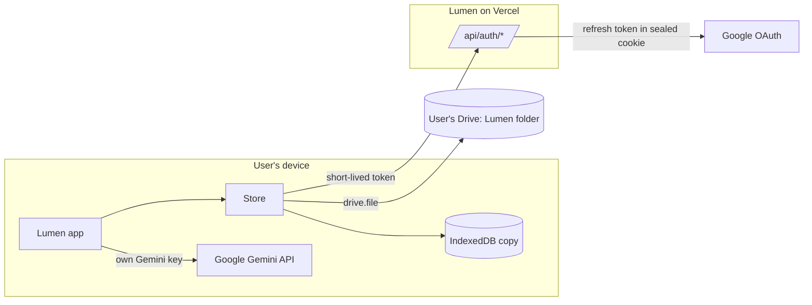

# How Lumen fits together

Lumen is a Next.js app (App Router, Next.js 16) that runs almost entirely on the user's device. Each person brings their own storage (Google Drive) and their own AI (a Gemini key), so Lumen stays free at any scale.

## Sign-in

- `/api/auth/google/start` sends the user to Google with PKCE and a random `state`. Scopes: `openid email profile drive.file`, with offline access.
- `/api/auth/google/callback` checks `state`, exchanges the code, and stores the session (Google refresh token included) in an `httpOnly` cookie sealed with AES-256-GCM (`src/lib/server/seal.ts`). There is no database of tokens.
- `/api/auth/token` hands the app a short-lived Google access token for Drive, refreshing it when needed.
- `/api/auth/signout` clears the cookie; `?disconnect=1` also revokes Lumen's access at Google.

## Storage (`src/lib/store`)

- `idb.ts`: a small key-value store in IndexedDB. Every read comes from here, so the app opens instantly and works offline.
- `drive.ts`: the Drive client. It finds or creates the `Lumen` folder and keeps one JSON file per document (`profile.json`, `ai.json`, `blocked.json`, `added.json`).
- `merge.ts`: every document is saved as `{ v, at }`. When the device and Drive disagree, the newer copy wins; on a tie the device copy stays.
- `store.ts`: writes go to the device first, are marked dirty, and sync to Drive about a second later, or when the device comes back online. `useStore()` re-renders components when anything changes.

Users who skip Google sign-in use "device" mode: everything stays in IndexedDB until they connect Drive from the You page.

## AI (`src/lib/gemini.ts`)

The user's own key is checked with Google (`GET /v1beta/models`) before it's saved, and every AI call goes straight from the device to Google. The key is stored only in the user's Drive and on their device.

## Daily plan (`src/lib/plan.ts`)

A pure function, so every device picks the same focus for the same day. Weekly and Daily areas appear once per cycle, starred areas twice (never on consecutive days), "Sometimes" areas every second cycle, and Sunday is the weekly review. News topics and paused areas never become a focus.

## Design system

Tokens live in `src/app/globals.css` (ivory `#F7F5F0`, charcoal `#17161C`, antique gold `#B08D4F`, plus a dark theme). Fonts are bundled from npm (`@fontsource`), so they work offline: Cormorant Garamond for headings, Jost for text, JetBrains Mono for numbers. Shared components are in `src/components/ui.tsx`.

## Tests

`npm test` covers the cookie seal, sync merge rules, the daily plan, the Gemini key check and the Drive client (against a fake Drive).
